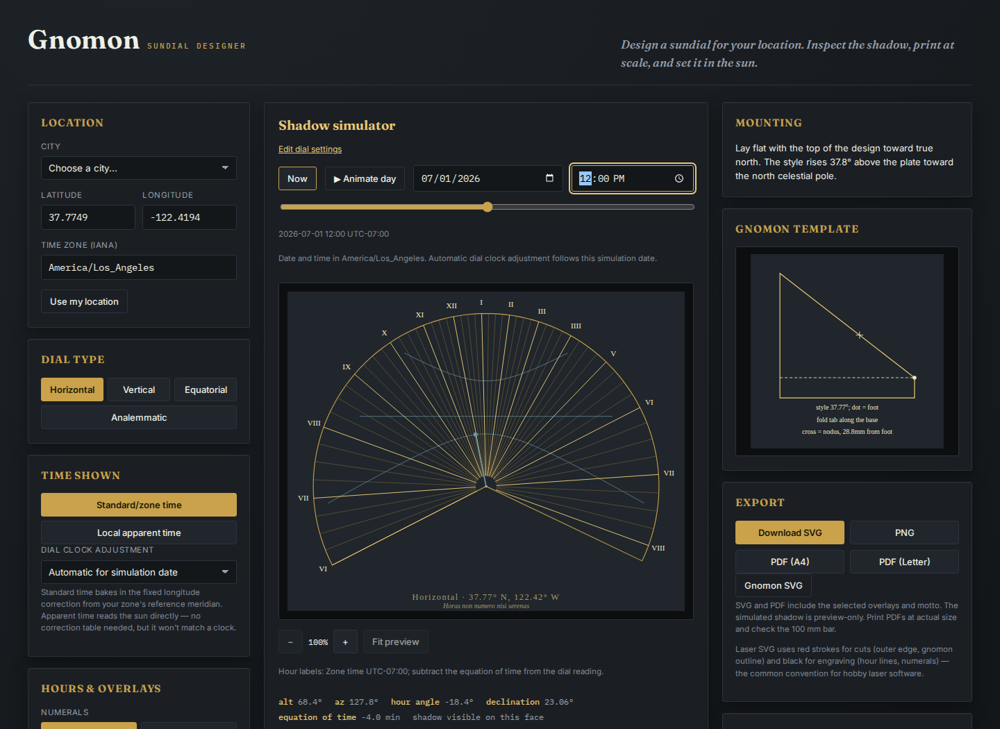
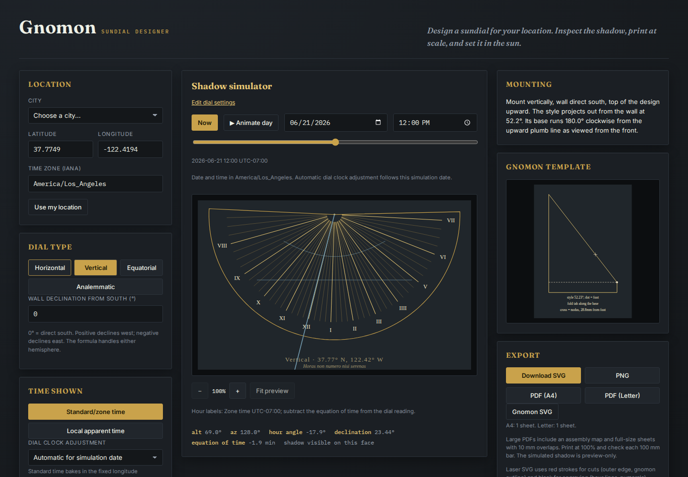
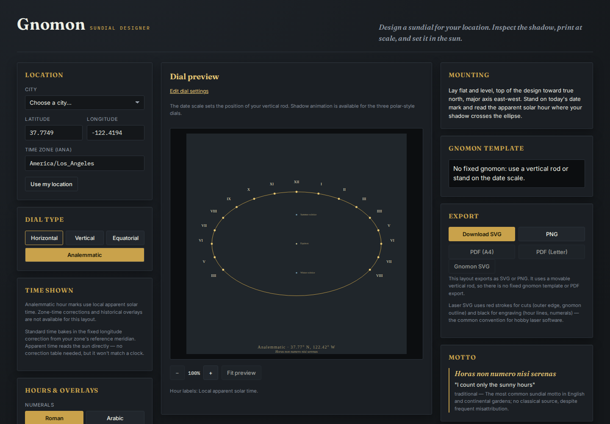
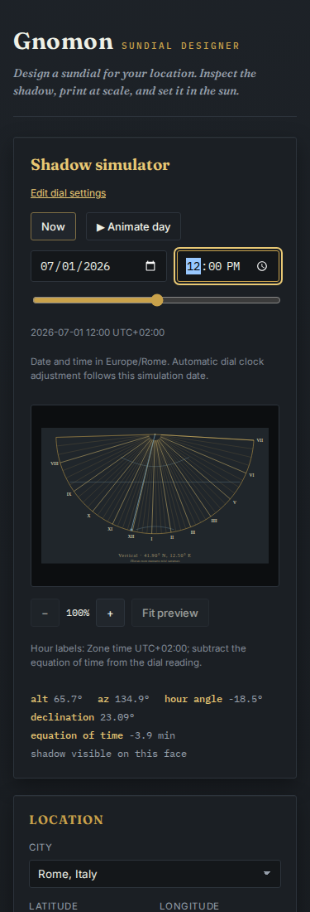

# Gnomon

**Design a sundial for your location. Inspect its shadow and export a construction drawing at physical scale.**

[](LICENSE)
[](https://antonsoo.github.io/gnomon/)



A construction drawing has to connect the location, receiving face, physical
gnomon and clock convention. Gnomon uses a 3D shadow model for polar-style
dials and a separate analemmatic model, with solar-position calculations,
hand-calculated physical examples and ray-casting checks. SVG and PDF use
millimetres; PDF includes a calibration bar to check after printing.

**Printable construction kit (source checkout).** Each PDF now
contains the plate and its matching gnomon, with mounting marks, nodus placement
and assembly instructions. Large pieces tile across ordinary A4 or Letter sheets.
The hour numerals stay inside the cut, and steep styles keep their exact angle
without becoming metre-tall triangles. [Open a real kit and inspect the measurements](docs/construction.md).

The [construction and simulation audit](docs/construction-audit.md) explains
the wall-shadow error found in the original geometry and its oracle, the
correction, and what remains outside the verification.

**Both faces of an equatorial dial (source checkout).** The construction PDF
now includes the pole-facing and opposite faces, their shared cut and alignment
target, and a rod gauge for equal exposed lengths on both sides. Winter hour
numbers reverse when viewed from the back; the summer face cannot simply be
copied there. Large pieces still tile across A4 or Letter sheets. The same
work corrects distorted hour directions at the geographic poles.
[Open the printable kit and measured drawings](studies/equatorial-faces/README.md).
The designer's preview and ordinary SVG/PNG download still show the pole-facing
face; the library and runnable example expose either face separately.

**Editable design files (source checkout).** Save the complete setup, reload
or move to another browser, and reopen it with the same dimensions and selected
clock minute. A winter design keeps its winter clock adjustment. Invalid files
leave current work intact. [Design-file guide and examples](docs/design-files.md).

**PDFs after disconnecting (source checkout).** Once the designer has loaded,
its first A4 or Letter export works offline, including designs edited or opened
after disconnecting. The PDF writer now loads with the app, increasing the
initial transfer instead of requiring a separate script at export time.
[Offline downloads, drawing comparisons and initial-load sizes](studies/offline-pdf/README.md).

## Quickstart

```bash
git clone https://github.com/antonsoo/gnomon.git && cd gnomon
npm ci
npm run dev
```

Use Node 24 for development. Open the printed local URL. Or use the [live demo](https://antonsoo.github.io/gnomon/) --
no install needed.

## Features

- **Dial types**: horizontal (the primary one), vertical (direct-south or
  declining, either hemisphere), equatorial, and analemmatic (the garden
  dial where a person is the gnomon).
- **Plate shape**: a "fan" (the classic look -- the plate is cut to the
  wedge containing the hour lines and style base, with room for the end numerals, root at the point) or a traditional full circle, your choice.
- **Hour lines** in standard/zone time (with the longitude correction from
  your zone's reference meridian and an optional DST offset) or local
  apparent solar time -- with half- and quarter-hour marks, Arabic or Roman
  (traditional "IIII", not "IV") numerals.
- **Historical hour systems** as overlays: temporal ("Roman") unequal hours,
  Babylonian hours (from sunrise), Italian hours (from sunset) -- each
  computed as a swept curve across the year, because none of them has a
  closed form.
- **Declination (date) lines** for the solstices, equinox, and optionally
  the zodiac entries, for a nodus on the style.
  Analemmatic standing marks name **June** and **December**, so they work in
  either hemisphere. [Standing marks and vertical-rod setup](studies/seasonal-marks/README.md).
  Zodiac entries cover all twelve signs. Coincident or crowded standing labels
  use lettered ticks and a printed key, retaining their physical positions.
  [Actual overlapping drawings, complete scale and native measurements](studies/calendar-scale/README.md).
- **A standing mark for your chosen date.** Select a local date and time on an
  analemmatic dial; its open ring and distance from centre locate the vertical
  rod for that minute. Native SVG/PNG retains the ring and clock label; saved
  designs reopen the same minute, including repeated clock times.
  [Selected-date construction and independent checks](studies/selected-standing/README.md).
- **Equation of time** table for the simulation year, computed from the same
  solar ephemeris. The library also exposes a daily curve, including leap days.
- **Gnomon template**: a triangular style with an attached mounting tab,
  engraved fold, matching foot/base-end marks and nodus position (or, for the equatorial dial, the plain rod its geometry
  actually calls for -- see [Accuracy and limitations](#accuracy-and-limitations)).
- **Curated Latin mottoes**, each attribution checked rather than assumed
  (most sundial mottoes are anonymous folk Latin, not a Roman poet).
- **Save/open designs (source checkout)**: portable `.gnomon.json` files retain
  construction settings, appearance and a fixed simulation minute, including
  repeated clock times. Reopen offline; canceled or invalid reads preserve current work.
- **Export**: SVG in physical millimetres for laser cutters (red = cut,
  black = engrave); PDF at exact print scale for A4 and US Letter with a
  100mm calibration bar on every sheet and the matching gnomon template;
  large plates and styles tile automatically with 10 mm overlaps and separate
  assembly maps; PNG.
- **Live simulation** for the three polar-style dials: date and time in the
  selected location's zone, sun altitude/azimuth and nodus shadow, with day
  animation. Skipped clock times are rejected; repeated times offer both
  occurrences. Automatic clock adjustment follows the simulation date.
- **Inspect and recover**: zoom the preview to 400% without changing export
  scale, scroll it with the keyboard, and correct invalid fields without
  losing the last valid drawing. Exports wait until the form is valid.
- **Location**: latitude/longitude entry, geolocation, a built-in gazetteer
  including historic astronomy sites (Alexandria, Aswan/Syene, Athens, Rome,
  Babylon, Samarkand, Jaipur), and time-zone detection via `Intl`.

## How it works

### One shadow-casting model, three dial types (plus the analemmatic's own)

`src/lib/geometry.ts` works entirely in 3D vectors (local East-North-Up
frame). Given a dial plane (an origin, an outward normal, and an in-plane
basis) and the gnomon's style -- a line parallel to Earth's rotation axis,
projecting out of the receiving face -- it projects the style's shadow
onto the plane for a given hour angle. Horizontal, vertical (direct or
declining) and equatorial dials are all "the shadow of a polar style on a
plane"; they differ only in which plane:

| Dial | Plane normal | Reference (u) axis |
| --- | --- | --- |
| Horizontal | straight up | true north |
| Vertical | horizontal, at the wall's declination from south | straight up the wall |
| Equatorial | Earth's rotation axis itself | (arbitrary in-plane reference) |

That means one derivation to get right, not four, and it is exactly what
the oracle test (below) re-derives independently to check against.

The analemmatic dial is different in kind -- there is no fixed polar style,
just a person (or a vertical rod) standing at a date-dependent spot -- and
is derived separately in `src/lib/dials/analemmatic.ts` as the orthogonal
projection of an equatorial dial's hour points onto the ground.

### Solar position

`src/lib/astronomy.ts` implements the low-precision solar position
algorithm behind the NOAA Solar Calculator (itself Jean Meeus, *Astronomical
Algorithms*, 2nd ed., 1998, ch. 25 & 28): geometric mean longitude and
anomaly, the equation of center, apparent longitude, and the obliquity of
the ecliptic, giving declination and the equation of time to about 0.01
degree for dates within a few centuries of the present. Measured against an
independent ephemeris (Skyfield with JPL DE421, at 12:00 UTC every 17 days
from 1900 to 2050, `tests/ephemeris.test.ts`), it stays within 0.0034 degrees
of the apparent declination and 3.8 seconds of the equation of time.

### The oracle test suite

The library's own hour-line code (`src/lib/geometry.ts`) uses 2D trig-style
vector projection. `tests/oracle.test.ts` is a **separate** implementation:
its own vector kit, its own sun-direction formula (built as a change of
orthonormal basis / rotation rather than the altitude/azimuth spherical
trigonometry `astronomy.ts` uses), and its own ray/plane intersection. The
two sun-direction formulas were cross-checked numerically to six decimal
places across a spread of latitude/declination/hour-angle combinations
before the oracle file was written, confirming they are independent
derivations of the same physics rather than one copied from the other.

The suite then, for many latitudes, longitudes, dates and dial types:

1. Builds a real dial with the library.
2. Ray-casts the sun's shadow in 3D from scratch for the hour angle
   corresponding to each labeled clock hour.
3. Asserts the two land on the same line, within 1e-6 radians.
4. Separately checks horizontal- and direct-vertical-south dials against
   their published closed forms (`tan(theta) = sin(phi) * tan(H)` and
   the co-latitude-with-mirroring relationship for vertical dials,
   respectively -- Waugh, *Sundials: Their Theory and Construction*, ch. 3-4).
   The wall comparison checks the physical ray direction, including the
   downward noon ray on an equator-facing wall.
5. Checks the analemmatic dial by an unrelated method: computing the true
   sun azimuth for a given date/time and confirming a plain vertical rod at
   that date's gnomon position casts its shadow in the exact direction of
   the corresponding point on the hour ellipse.

The ray-casting suite is supplemented by absolute wall-shadow coordinates,
a numerical daylight sweep and measured export geometry; see
[Accuracy and limitations](#accuracy-and-limitations) for what it does and
doesn't guarantee.

## Usage example (library)

The library has no npm package published yet (see [Contributing](#contributing));
within this repo, or after cloning it, import it by relative path. A runnable
version of this example is in `examples/basic-horizontal-dial.ts`
(`node examples/basic-horizontal-dial.ts` with Node 24).

```ts
import { buildHorizontalDial } from "./src/lib/dials/horizontal.ts";
import { renderPolarDialSVG } from "./src/lib/render/svg.ts";

const dial = buildHorizontalDial({
  latitudeDeg: 37.7749,
  timeReference: { mode: "standard", longitudeDeg: -122.4194, zoneMeridianDeg: -120, dstOffsetHours: 1 },
  hourLineOptions: { startHour: 5, endHour: 19, stepHours: 0.25 },
  nodusDistanceMm: 30,
  gnomonBaseLengthMm: 60, // maximum base or rise; extends if needed to reach the nodus
});

console.log(dial.orientation);
// "Lay flat with the top of the design toward true north. The style rises
// 37.8° above the plate toward the north celestial pole."

const svg = renderPolarDialSVG(dial, {
  radiusMm: 90, innerRadiusMm: 6, plateShape: "fan",
  numerals: "roman", theme: "brass",
  showDeclinationLines: true, showHistoricalHours: false,
});
// Canvas size follows the sector containing the usable hour rays.
// The root SVG width and height use millimetres.
```

The library (`src/lib/`) has no dependency on the DOM or on the UI code in
`src/main.ts`; it is plain, tree-shakeable TypeScript.

## Screenshots

| Vertical dial, live shadow at 3pm | Analemmatic dial | Mobile (390px) |
| --- | --- | --- |
|  |  |  |

## Accuracy and limitations

- **Solar position** is accurate to about 0.01 degree for dates within a
  few centuries of the present (the NOAA/Meeus low-precision algorithm);
  against JPL DE421 from 1900 to 2050 it is within 0.0034 degrees in
  declination and 3.8 seconds in the equation of time. It does not account
  for atmospheric refraction, which shifts the sun's
  apparent position near the horizon by up to about 0.5 degree -- irrelevant
  for hour-line geometry (computed at a fixed reference declination, not
  from the horizon), but worth knowing if you compare the live simulation
  to the sun's visual position at sunrise/sunset.
- **Hour-line geometry** is checked by the independent oracle described
  above, across 9 latitudes from -60 to 78 degrees, multiple wall
  declinations, and a real-date/DST end-to-end case -- but the oracle
  shares this project's model of the shadow geometry, so what it guarantees
  is agreement: if the geometry code and the oracle ever disagree, you'll
  see a failing test, not a silently wrong dial. The solar positions that
  feed both are checked separately, against a committed fixture from
  Skyfield and JPL DE421 (`scripts/solar_oracle.py`), not a runtime
  dependency.
- **Historical hour curves** (temporal, Babylonian, Italian) are computed
  from the standard sunrise-equation definitions, sampled at 37 dates
  across the year; they are smooth enough to read but are not the same
  curve a Roman clockmaker's compass-and-straightedge construction would
  produce down to the last hairline.
  The source checkout restores Italian afternoon hours 17–23 and usable
  Babylonian hours beyond 16 on long days. An independent horizontal
  projection checks the complete hour ranges and sampled coordinates;
  [before/after curves and export evidence](studies/historical-hours/README.md)
  explain the model and grazing boundaries.
- **The equatorial dial's gnomon** is a plain rod perpendicular to the disc,
  with a printed length gauge. A style even slightly below 90 degrees retains
  its exact leaning angle. Templates with a triangle leg under 3 mm are labelled
  as angle gauges for a rigid style rather than paper folds.
- **Analemmatic date-scale formula** (`offset = R * cos(phi) * tan(delta)`)
  was derived independently in this repository (not copied from a single
  external source) and cross-checked against the general 3D shadow model
  before being trusted; see the derivation comment in
  `src/lib/dials/analemmatic.ts`.
- **PDF export** includes the plate and style. Small pieces each use one page;
  large pieces tile at full scale. Print at Actual size / 100% and verify every bar and frame. The guide
  is reduced; the construction sheets are not. The planner caps output at
  64 construction sheets per piece. [Digital assembly checks](docs/printing.md) do not
  establish physical printer or paper accuracy.
- **Simulation dates** range from 1900 to 2100. Local-time conversion uses
  the browser's time-zone data; future political changes require updated
  browser data. The automatic clock adjustment uses the actual offset at
  the chosen instant. Manual "standard time" uses the minimum monthly
  offset sampled for that year, which is an approximation in zones with
  negative DST or permanent offset changes.
- **Analemmatic** hour marks use apparent solar time; they have no zone-time
  or historical-hour option and no animated shadow, PDF or fixed-style
  template. The UI exposes these limits before export.
  The open standing ring follows the selected local minute using the existing
  solar ephemeris. Its printed distance rounds to 0.1 mm; this is a display
  precision, not a fabrication or field-accuracy guarantee. Choose another date
  to generate its standing point.
- **Equatorial** construction PDFs include both faces; the designer preview
  and ordinary SVG/PNG download show the pole-facing face. Both faces share
  the same fixed clock convention. Neither works at the ideal equinox, and
  a back face cannot provide daylight during polar night. You supply the
  tilted support, backing and a rod long enough to protrude from both sides.
  [Construction, numerical checks and remaining physical limits](studies/equatorial-faces/README.md).
- **Degenerate orientations** (for example a horizontal polar style at
  the equator, or an east/west wall with the style in its plane) cannot
  make a usable dial in this model. The UI explains the problem and pauses
  exports. Near-degenerate styles can be impractically tall; dimensions
  describe geometry, not a fabrication recommendation.
- Hour-ray visibility uses a nominal annual declination range of
  +/-23.44 degrees and requires the sun above the horizon and in front of
  the face. Terrain, refraction, material thickness and mounting errors
  are not modeled. No physical fabrication or field measurement was
  performed as part of the automated verification.
- Date curves preserve unusable sampled shadows as breaks, including polar-day
  receiving faces. Their 3.75-degree hour-angle sampling remains an approximation;
  visibility boundaries are not solved analytically.
  [False-chord reproduction and native SVG/PDF measurements](studies/shadow-gaps/README.md).
- PNG is a raster preview, bounded to 16 megapixels and 8192 pixels per
  side. Large designs are downsampled and report their effective resolution.
  Use SVG or PDF for physical scale. Async exports retain the complete
  design selected at the time of the click, even if the form changes.

## Development

```bash
npm ci
npm run lint       # eslint
npm run typecheck  # tsc --noEmit, strict
npm test           # vitest (astronomy, the DE421 ephemeris check, time zones, dial geometry, misc data, export, and the oracle suite)
npm run build      # tsc -b && vite build; static site in dist/
npm run test:browser # production workflows in Chromium and Firefox
```

To regenerate the ephemeris fixture (downloads DE421, about 17 MB, on first
use): `uv run --with skyfield python3 scripts/solar_oracle.py`.

Browser setup on a new machine: `npx playwright install chromium firefox`.
The browser suite checks city-local times across device zones, DST transitions,
late location callbacks, invalid input, delayed and failed downloads, SVG/PDF/PNG
artifacts, preview zoom, 320/375/1440px layouts, accessibility, CSP violations
and off-origin requests. See the [audit](docs/construction-audit.md) for evidence.

## Contributing

See [CONTRIBUTING.md](CONTRIBUTING.md).

## License

[MIT](LICENSE) (c) 2026 Anton Soloviev.

---

<sub>Part of [Officina](https://antonsoo.github.io/officina/), a set of small open-source tools by [Anton Soloviev](https://github.com/antonsoo).</sub>
