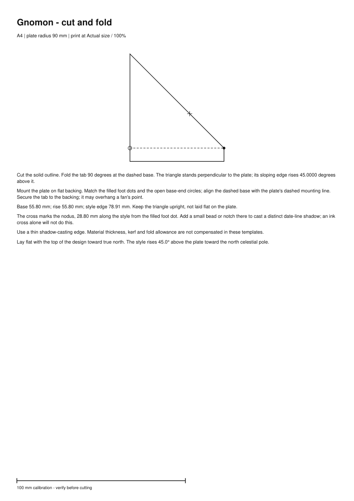
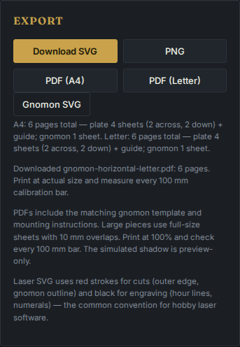

# Print the plate and its matching gnomon

The PDF buttons now download a construction kit: the plate, its shadow-casting
piece, matching mounting marks and instructions. Both pieces use physical
millimetres. Large pieces tile independently across ordinary A4 or Letter
paper, with overlaps and calibration bars. The [2026-10-10 source verification](verification-2026-10-10.md)
records the fresh artifact checks performed before pushing this work.

Equatorial construction PDFs now include **both faces** and a gauge for the
rod's exposed half-length. Their P- and O-prefixed sheets assemble separately
on opposite sides of the same backing. Align the foot dots and target A before
trimming; leave the stated rod length exposed on each side and add the backing's
thickness to the whole rod. [Printable example, hemisphere conventions and
independent native measurements](../studies/equatorial-faces/README.md).

Try the [two-page garden dial](../examples/printing/garden-a4.pdf), or the
actual browser downloads of a 300 mm circle in
[A4](../examples/printing/north-a4.pdf) and
[Letter](../examples/printing/north-letter.pdf). These examples are for latitude
45 degrees north, longitude zero, apparent solar time. The garden dial has
a 90 mm radius; the circles have a 150 mm radius. Enter your own location
before making a dial for use elsewhere.



This is a rendered PDF page, not a photograph of a physical build.

## Make the two pieces agree

Print one-sided at **Actual size / 100%**, with Fit and additional poster
tiling disabled. Measure every 100 mm bar and each tiled frame in both axes.
The [sheet assembly instructions](printing.md#print-and-assemble) explain
trimming only the blank margins and retaining the 10 mm printed overlaps.

```text
PDF download
|
+-- Plate: compact sheet OR guide + R1C1, R1C2, ...
|
+-- Gnomon: compact sheet OR guide + G-R1C1, G-R1C2, ...

Assemble the two groups separately, then mount the gnomon on the plate.
Reduced maps are not cutting templates.
```

On a triangular template, the filled dot marks the foot of the sloping
shadow-casting edge. The open circle marks the other end of its base. Match
those marks to the same marks on the plate; align the dashed base with the
plate's dashed mounting line. Fold the tab 90 degrees so the triangle stands
upright. Use flat backing, since the mounting tab can overhang a fan's point.
The printed orientation tells you how to position the resulting dial.

The cross marks the nodus at a measured distance **along the style from its
foot**. Add a small bead or notch there to cast a distinguishable shadow for
the date curves. A printed ink cross does not create that shadow. The
[British Sundial Society's construction terminology](https://sundialsoc.org.uk/all-about-sundials/how-sundials-work/part-4-how-sundials-work/)
explains the style, nodus and effects of gnomon thickness.

For a truly perpendicular style, the PDF provides a rod-length gauge, with
the foot and nodus marked. The length is measured outward from the plate
surface; any buried mounting length must be added separately.



## Defects found by following the construction workflow

At baseline `cce5033`, the triangular template held its base fixed while its
height grew as `base * tan(angle)`. Near 90 degrees this made the template
enormous. Above 89.9 degrees, the renderer instead substituted a normal rod,
silently changing the angle. A separate inspection found that some wall
dials' mounting bases were outside their fan cuts.

| Reproduced case | Before | Current output |
| --- | --- | --- |
| Horizontal, 89 N, radius 90 mm | SVG height 3234.15 mm | SVG height 103.80 mm; style angle remains 89 degrees |
| Horizontal, 89.91 N, radius 90 mm | Rod at 90 degrees | Exact 89.91-degree angle gauge, with a narrow-leg notice |
| Vertical, 45 S, wall -45 degrees, radius 90 mm | Base endpoint outside the cut | Base endpoint inside the expanded fan, with matching marks |
| Tall narrow wall fan, 89.91 S, wall +35 degrees, radius 235 mm | Compact PDF failed because mounting notes did not fit | Separate plate guide and full-size sheets |
| Browser PDF download | Plate only; separate SVG needed for the gnomon | Matching plate and gnomon in the same PDF |

The [before/after measurements](evidence/construction/comparison.json) and
[original SVG files](evidence/construction/before.zip) retain the first three
reproductions. The tall narrow case is included in the current PDF matrix.

The new triangle is sized by a maximum base/rise envelope. For style angle
`a`, envelope `s` and nodus distance `n`:

```text
style length = max(s / max(cos(a), sin(a)), n)
base         = style length * cos(a)
rise         = style length * sin(a)
```

The application uses `s = 0.62 * radius` and `n = 0.32 * radius`. Neither
hour geometry nor nodus coordinates change. The library's existing
`gnomonBaseLengthMm` input now sets the maximum of the two triangle legs;
a larger explicit nodus distance takes precedence. Returned `baseLengthMm`,
`heightMm` and `styleLengthMm` describe the actual piece. Only a perpendicular
style, within floating-point roundoff, becomes a rod.

The fan sector contains the mounting-base direction as well as the hour
rays. Its angular clearance still protects the end numerals. The mounting
line and markers are black engravings in the laser SVG; the outer cut stays
red. `exportConstructionPDF` is the new combined library export, while
`exportPolarDialPDF` remains available for a plate-only export.

## Measurements of the emitted pieces

`scripts/verify-construction.py` reads the actual SVG and PDF files. It does
not import the TypeScript geometry. It measures triangle legs, style length,
nodus position, plate mounting direction, cuts and scale bars, and checks that
the two pieces agree. It virtually stands each measured style upright on
the measured mounting line and compares its direction with a separately
constructed celestial-pole vector in local east/north/up coordinates.

For tiled styles it checks complete sheet grids, drawing coverage, clipping,
repeated vector coordinates and paired registration targets. The existing
plate verifier also checks numeral glyph containment and raster overlap
agreement. These are digital measurements, not printer tolerances.

| Retained artifacts | Measured result |
| --- | --- |
| 26 PDFs, both paper sizes, 13 location/size/type combinations | 192 pages, including 42 style pages |
| Matrix sheet joins | 169 plate seams and 12 style seams |
| Largest style dimension discrepancy in PDF coordinates | Less than 0.00002 mm |
| Largest assembled-style axis discrepancy | Less than 0.000021 degrees in reconstructed geometry |
| Four actual Chromium/Firefox PDF downloads, with their SVG parts | 24 pages; all dimensions and mounting checks passed |
| Deliberately invalid kits | Rejected a 3% style shrink, a missing style tile, and an 89.91-degree style substituted for an 89-degree design |

The cases include both hemispheres, declining walls, a misplaced-base
regression, near-normal and near-flat styles, poles, equatorial rods,
400 mm radius pieces and the tall narrow notes regression. Complete files
and SHA-256 manifests are in [matrix.zip](evidence/construction/matrix.zip)
and [browser.zip](evidence/construction/browser.zip). The detailed reports
are [matrix verification](evidence/construction/matrix-verification.json)
and [browser verification](evidence/construction/browser-verification.json).

The 3 mm warning and page-layout boundary were also exercised through 476
exports spanning radii 170-250 mm, seven latitudes, horizontal/declining-wall
dials and both paper sizes. The initial pass found nine compact-plate note
overflows; after reserving space for those notes, all 476 exports succeeded.
This sweep checks successful generation, not fabrication accuracy.

Regenerate and measure the files from an installed checkout with Node 24
and `uv`:

```sh
node scripts/construction-fixtures.mjs test-results/construction
uv run scripts/verify-construction.py test-results/construction --check-controls --report test-results/construction-report.json
```

Or inspect the retained bytes:

```sh
python -m zipfile -e docs/evidence/construction/matrix.zip test-results/retained-construction
uv run scripts/verify-construction.py test-results/retained-construction --check-controls
```

Use `--render <directory>` to save selected PDF pages as images. The pinned
Python readers are verification tools, not application dependencies. For
fresh browser downloads, run the production preview and
`scripts/capture-prints.mjs` as described in [printing.md](printing.md#repeat-the-artifact-checks),
then use the construction verifier on its output directory.

## Clean-checkout verification

A fresh detached checkout of `53dee8b` was verified with Node 24.21.0 and
npm 11.19.0 on 2026-10-09:

| Command or workflow | Result |
| --- | --- |
| `npm ci`, `npm run lint`, `npm run typecheck` | Passed |
| `npm test`, repeated with `LC_ALL=de_DE.UTF-8 LANG=de_DE.UTF-8` | 269 passed in each locale |
| `npm run build`, `npx playwright test` | Production build; all 44 Chromium/Firefox workflows passed |
| `node examples/basic-horizontal-dial.ts` | Valid SVG; 53 hour lines and 3 declination lines |
| Regenerate and independently measure all 26 construction PDFs | All checks passed; all three invalid-kit controls rejected |
| Extract and remeasure the retained matrix and browser archives | Hashes, dimensions and assembly checks passed |
| `uvx ruff check scripts/verify-construction.py`, `uvx ruff format --check scripts/verify-construction.py` | Passed |
| Compare fresh Node 24 and working Node 26 production output | All 35 files have identical SHA-256 hashes |
| Fresh development server, browser PDF download | Correct download; no page errors |

The browser checks include asynchronous click-time snapshots, invalid-input
recovery, near-normal angle gauges, rod templates, keyboard use, accessibility
and phone layouts. The [desktop capture](assets/construction/large-desktop.png),
phone Export panel, full-size style pages and reduced maps were visually
inspected. They retain the existing drawing-focused UI and show the complete
kit's page count before download. Large template lettering in the thumbnail
is small; the PDF provides the full-size drawing and readable instructions.

## Fabrication limits

No physical print, folded assembly, cutter trial or outdoor reading has been
performed. Thin-edge geometry does not compensate for material thickness,
kerf, fold allowance, paper stretch or printer distortion. Building a thick
gnomon changes the shadow geometry; the paper template does not correct it.

If either triangle leg is under 3 mm, the UI and PDF label it an **angle
gauge for a thin rigid style** and require a separate support. This threshold
is a construction heuristic, not a certified manufacturing limit. Very small
angles may be impractical to reproduce accurately even with the correct
drawing. The gauge does not promise a self-supporting paper triangle.

The app retains its 30-400 mm radius range. PDF work is capped at 64 full-size
sheets per piece. Equatorial output is still the pole-facing face only;
analemmatic dials still use SVG/PNG and a movable vertical gnomon. Long custom
library notes can still be rejected when they exceed the available page.

Build with `npm run build`; the static site is written to `dist/`.
Nothing in this change has been pushed, released or deployed.
