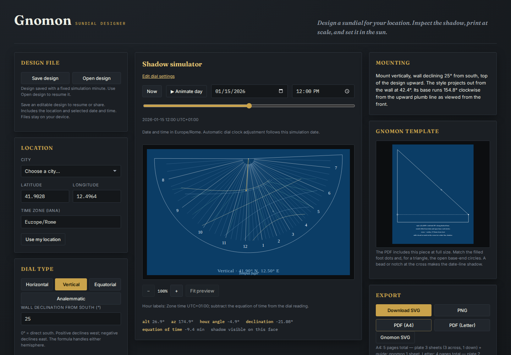
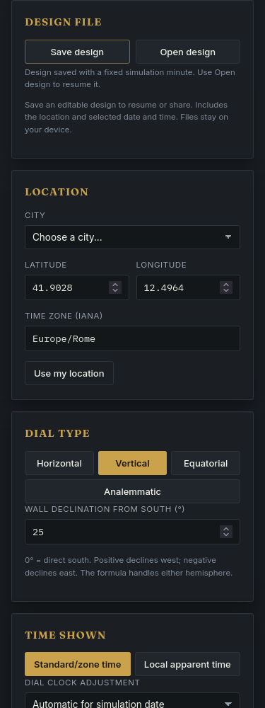
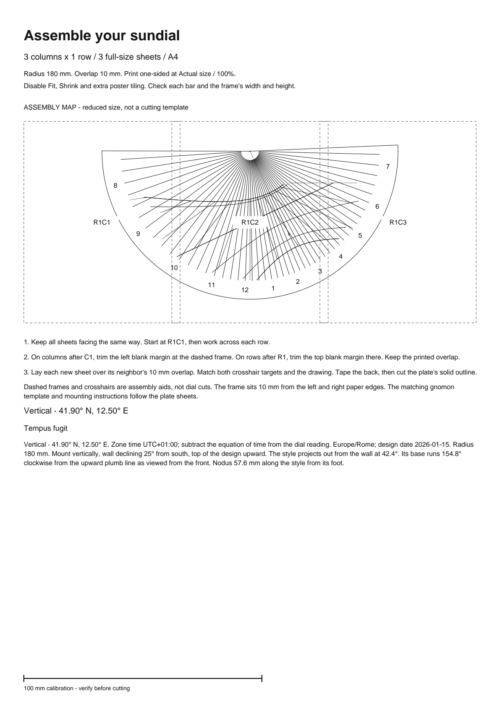

# Editable design files: retained workflow

Implementation `280eb2657f1deaa6c9763b57e5c48a551889a5c4` adds explicit
save/open files to the source checkout. The [format and usage guide](design-files.md)
includes four editable examples. This feature has not been deployed to Pages.

## The missing workflow

At baseline `4bdf1eb`, a Rome wall design could be exported as a drawing but
could not be saved as editable settings. Reloading discarded the setup. The
[baseline browser record](evidence/design-files/before.json) captures an actual
Chromium run with a fixed clock:

| Setting | Before reload | After reload |
| --- | --- | --- |
| Location | Rome, 41.9028 N, Europe/Rome | San Francisco, 37.7749 N, America/Los_Angeles |
| Dial | Vertical wall, 25 degrees | Horizontal |
| Radius | 180 mm | 90 mm |
| Simulation | 2026-01-15 12:00 | 2026-07-01 12:17 |
| Save/open controls | None | None |

The new workflow saves the inputs and selected local minute to a 603-byte
[Rome design file](evidence/design-files/rome.gnomon.json), then reopens them
after a reload. No automatic browser persistence was added.

## Actual downloads and offline reopening

[The replay](../studies/design-files/replay.mjs) ran against the clean production
build in Chromium and Firefox, each at 1440 and 375 CSS pixels. Chromium's device
zone was UTC; Firefox's was Asia/Tokyo. Each run opened the Rome example,
downloaded its editable file and construction SVGs, reloaded into defaults,
went offline, and opened the downloaded file again.

All four runs restored the wall angle, radius, winter date and noon simulation.
The design file and both SVG exports were byte-identical before and after
reopening within each browser. The design JSON also matched across browsers;
the SVG hashes differed between engines, so this is not a claim of identical
SVG serialization across browsers. All runs had no uncaught errors, no requests
to other origins, and no horizontal page overflow. See the
[browser receipt](evidence/design-files/browser.json).

Retained Chromium downloads:

| Output | Before reopening | After reopening | Comparison |
| --- | --- | --- | --- |
| Plate SVG | [before](evidence/design-files/plate-before.svg) | [after](evidence/design-files/plate-after.svg) | Identical bytes |
| Gnomon SVG | [before](evidence/design-files/gnomon-before.svg) | [after](evidence/design-files/gnomon-after.svg) | Identical bytes |
| A4 construction PDF | [before](evidence/design-files/construction-before.pdf) | [after](evidence/design-files/construction-after.pdf) | All five page sizes and rendered pages identical |

PDF files differ in bytes. An independent PDFium reader rendered all five pages
at 144 dpi and compared every RGB byte; all matched. The PDF module was loaded
in the new page before the offline step. This does not establish that the first
PDF export after loading the app works offline without that module available.

All nine fetched HTML, script, stylesheet and font responses matched the clean
`dist/` files by size and SHA-256. The [artifact verification](evidence/design-files/verification.json)
records those results, PDF page hashes, actual download hashes and the complete
build manifest. Run its reader against fresh replay output and the build served:

```bash
# Terminal 1, after npm ci and npm run build
npm run preview -- --host 127.0.0.1 --port 4319 --strictPort

# Terminal 2; replay-output must not already exist
node studies/design-files/replay.mjs http://127.0.0.1:4319/gnomon/ replay-output
python -m venv .venv-artifacts
.venv-artifacts/bin/pip install pypdfium2==5.14.0 Pillow==12.3.0
.venv-artifacts/bin/python studies/design-files/verify-artifacts.py replay-output dist
```

All four screenshots and the rendered PDF guide were opened and visually
inspected. Controls and text fit their panels at both sizes. Phone captures
show the settings panel after scrolling to it.

| Chromium desktop | Firefox desktop |
| --- | --- |
| [](assets/design-files/chromium-1440.png) | [](assets/design-files/firefox-1440.png) |

| Chromium, 375 px | Firefox, 375 px | PDF assembly guide |
| --- | --- | --- |
| [](assets/design-files/chromium-375.png) | [](assets/design-files/firefox-375.png) | [](assets/design-files/construction-guide.png) |

## Clean checkout and failure cases

All 156 tracked files in a fresh archive matched the implementation commit.
Node 24.21.0 and npm 12.0.1 passed `npm ci`, type checking, lint, 294 unit checks,
the production build and 66 Chromium/Firefox browser workflows. The runnable
library example also succeeded. The final evidence additions do not change
the tested runtime files. See [check metadata](evidence/design-files/checks.json),
[clean-check output](evidence/design-files/clean-checks.txt) and
[browser output](evidence/design-files/clean-browsers.txt).

The new checks cover all four dial types, repeated DST minutes, a half-hour
zone, opening on a device with a different date and time zone, and changing a
minute without changing cached construction geometry. Malformed, oversized,
invalid UTF-8, unknown-field, duplicate-field and inconsistent-clock files
leave current settings and invalid input drafts intact. Controlled delayed
reads exercise cancellation, timeout, a newer file, edits during reading and
same-filename retry. Those read failures are simulated; the roundtrip downloads
above use real browser files.

The evidence establishes editable-input recovery in this build. It does not
establish physical printer accuracy, assembly, wall measurement or outdoor
time-reading accuracy. Future geometry changes may produce different drawings
from the same input file; preserve a finished SVG/PDF when that drawing matters.
