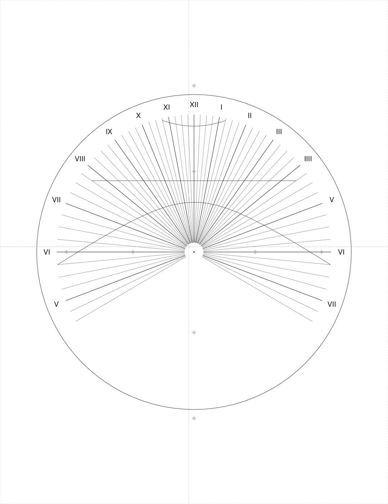
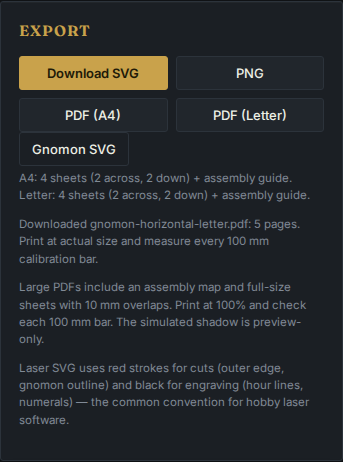

# Full-size sundials on ordinary paper

The source checkout can print a large polar-style dial across A4 or Letter
sheets. A 300 mm circle uses four full-size sheets and one assembly guide.
Small plates still fit on one sheet. This work is local and unreleased.

[Open the actual A4 browser download](../examples/printing/north-a4.pdf) or
[the Letter download](../examples/printing/north-letter.pdf). These examples
are for **45 degrees north, longitude zero, apparent solar time**, with a
150 mm radius. Enter your own location before making your dial.



This image is a digital assembly of rendered PDF pages, not a photograph
of a fabricated sundial.

## Print and assemble

1. Set the location, dial type, clock convention and radius. The Export panel
   shows the sheet count for each paper size before the download.
2. Select **PDF (A4)** or **PDF (Letter)**. Print on that paper, one-sided,
   at **Actual size / 100%**. Disable Fit, Shrink and the printer's own
   poster tiling: these files already contain the individual sheets.
3. Measure every 100 mm bar, and the frame's labelled width and height.
   If either axis is wrong or a frame is clipped, correct the printer settings
   before assembling. The tiled frame starts 10 mm from each paper side.
4. Start at R1C1 and work across each row. For columns after C1, trim the
   left blank margin at the dashed frame; for rows after R1, trim the top
   blank margin there. Keep the printed overlap.
5. Lay the new sheet over the neighboring sheet's 10 mm overlap. Match both
   crosshair targets and the drawing. Tape the back, then cut the solid plate
   outline. Gray dashed frames and crosshairs are assembly aids.
6. Download **Gnomon SVG** separately for the style template. Follow the
   mounting and nodus instructions for the selected design.

```text
Four-sheet example, viewed from the front:

       10 mm overlap
             |
     +-------+-------+
     | R1C1  | R1C2  |
     +-------+-------+  <- 10 mm overlap
     | R2C1  | R2C2  |
     +-------+-------+

The assembly guide is a reduced map, not a cutting template.
```



The title, motto and mounting notes are construction notes outside the cut
or on the guide. They are not engraved into the finished plate. The simulated
shadow is not included in construction downloads.

## The cut must retain the numbers

Artifact inspection found that both SVG and PDF put every numeral outside
the plate's cut. At baseline commit `ea0b525`, the 90 mm radius circle's
numeral anchors were at 95.4 mm. An independent PDF reader found **0 of 15
labels** fully inside the cut. The corrected sample retains **15 of 15**.
[Original defective PDF](evidence/printing/before-cut.pdf) and
[measured comparison](evidence/printing/cut-comparison.json).

The physical plate radius now stays fixed while hour lines and sampled date
curves stop before an internal numeral band. A fan gains angular clearance
beyond its first and last rays so its end numerals survive the straight cuts.
SVG and PDF use the same band and font size in millimetres. Astronomical
hour angles and nodus coordinates are unchanged. Curves are shown only in
the central drawing area; the numeral band has no date curves.

## What was measured

The verification reads emitted PDF bytes with **PyMuPDF 1.28.2**, independently
of the TypeScript layout calculation. It checks page dimensions, every 100 mm
bar, the cut's vertex radii, actual numeral glyph bounds, clipping frames,
complete row/column grids, reconstructed vector coordinates and matching
registration targets. It rasterizes neighboring sheets at 254 DPI and
compares the 10 mm overlaps, excluding the outer 0.2 mm frame stroke.

| Captures | Result |
| --- | --- |
| 14 PDFs: north/south horizontal, declining wall, equatorial, maximum radius and small controls, both paper sizes | 84 pages; 84 calibration bars; 90 seams checked |
| Four actual Chromium/Firefox downloads, both paper sizes | 20 pages; 20 bars; 16 seams checked |
| Largest measured cut-vertex radius discrepancy in the 14-PDF matrix | Less than 0.0001 mm in PDF coordinates |
| Largest measured reconstructed-coordinate discrepancy | Less than 0.0001 mm |
| Largest raster seam disagreement, gray-level difference over 24/255 | Less than 0.12% of compared pixels |
| Deliberately faulty PDF controls | Rejected a 3% drawing shrink, a 1 mm shift on one tile, and a missing tile, while leaving their calibration bars unchanged |
| SVG glyph bounds in Chromium and Firefox | Inside the exported cut across 336 combinations per browser: both hemispheres, three dial types, five wall directions, two shapes, two numeral styles and three radii |

The measurements concern PDF coordinates and rendered pixels. They do not
establish printer accuracy. The outline is sampled into 96 arc segments, so
measuring its vertices does not make the polygon an exact mathematical circle.
Fonts substituted by another SVG viewer can have different glyph bounds.

The complete PDFs and hash manifests are retained in
[the matrix archive](evidence/printing/matrix.zip) and
[the browser-download archive](evidence/printing/browser.zip).
Results are in [matrix verification](evidence/printing/verification.json) and
[browser verification](evidence/printing/browser-verification.json).

## Repeat the artifact checks

From an installed source checkout with Node 24 and `uv`:

```sh
node scripts/print-fixtures.mjs test-results/print-fixtures
uv run scripts/verify-prints.py test-results/print-fixtures --check-controls --report test-results/print-verification.json
```

Or check the retained bytes, including their SHA-256 hashes:

```sh
python -m zipfile -e docs/evidence/printing/matrix.zip test-results/retained-prints
uv run scripts/verify-prints.py test-results/retained-prints --check-controls
```

For actual browser downloads, start the production preview in one terminal:

```sh
npm run build
npm run preview -- --host 127.0.0.1 --port 4327 --strictPort
```

Then, in another:

```sh
node scripts/capture-prints.mjs http://127.0.0.1:4327/gnomon/ test-results/browser-prints
uv run scripts/verify-prints.py test-results/browser-prints
```

The fixture generator records its inputs, byte sizes, per-export elapsed time
and hashes. PDF metadata includes a generation timestamp and file ID, so new
exports need not have identical hashes; the verifier checks the geometry of
the newly produced bytes. The browser capture script also saves real screenshots.
Use `--render <directory>` on the verifier to save a digitally assembled
north/A4 or wall/Letter image. These Python packages are verification tools,
not application dependencies.

## Limits

No physical print, taped assembly, cutter trial or outdoor reading was
performed. Material thickness, kerf, paper stretch, printer margins and
mounting error remain outside this verification. Digital checks are not a
fabrication certificate.

The application supports radii from 30 to 400 mm; the PDF planner refuses
more than 64 full-size sheets before allocating a document. Analemmatic PDF
export remains unavailable. Equatorial output still covers only the
pole-facing face. Long custom library notes that do not fit are rejected
explicitly. Very small or near-degenerate dials can be hard to read or build;
contained numerals do not guarantee legibility for every location.
