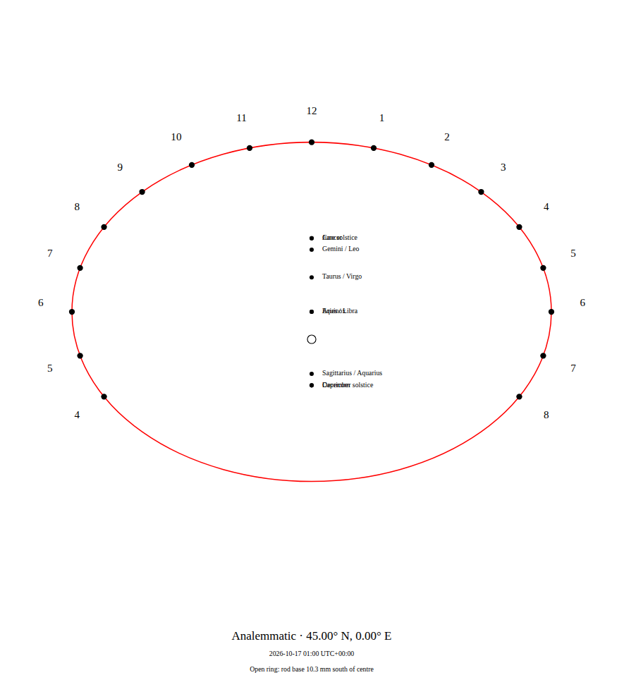
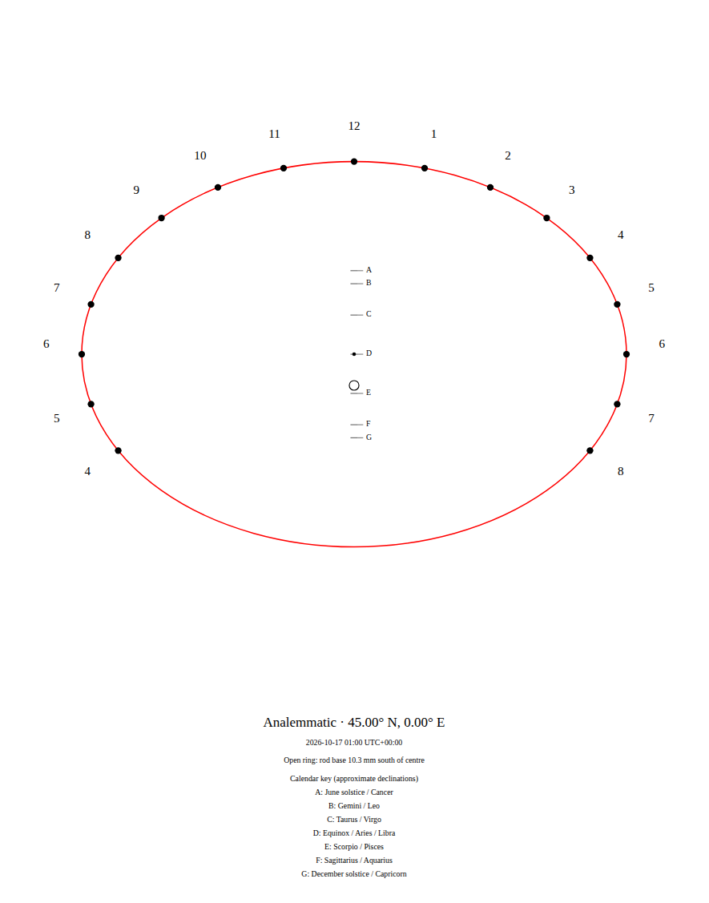
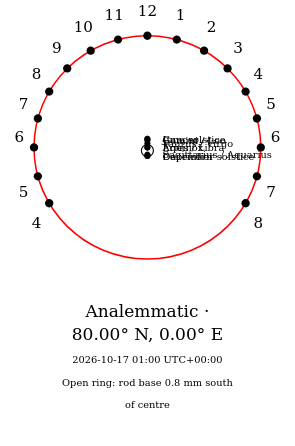
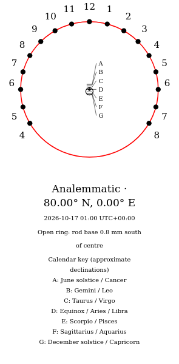

# Read the complete standing scale

Enabling zodiac entries previously omitted **Scorpio and Pisces** entirely.
The shared table had ten of the twelve tropical signs. On an analemmatic
drawing it also engraved independent labels at identical solstice/equinox
points, making June/Cancer, equinox/Aries/Libra and December/Capricorn overlap.
Small high-latitude scales crowded still more labels into the same area.





The missing pair now uses the existing approximate **-11.5-degree** convention.
All prior model positions are unchanged. Coincident or crowded labels use
lettered ticks and leaders to a readable, wrapped calendar key below the
geometry. Positions that coincide at the native SVG's 0.001 mm serialization
precision share one tick and retain all names in the key. Clear ordinary
calendar layouts keep their original native bytes. A small polar-limit noon
label also stays inside the drawing; its hour dot does not move.

The shared zodiac table also supplies optional date curves on polar-style
dials when the face can receive those Sun rays. This is an omitted table entry
and engraving-layout correction, not a new astronomical model. Traditional
sign-entry declinations are approximate and do not name exact contemporary
calendar dates or constellation boundaries. For an ordinary selected civil
date, use the existing open ring and its clock legend.

## Native evidence

Baseline source `7ae6ab4` produces the [before capture](before/replay.json).
Forty-eight authored native drawings cover both hemispheres, latitudes
10/45/80 degrees and limiting poles, semi-major axes 30/90/400 mm, with the
zodiac option on and off. Native font measurements in both browsers inspect
96 layouts: 730 overlapping label pairs, 96 missing sign labels and four
clipped hour labels become zero. These counts are this deliberate stress
matrix, not a population estimate. [Before](before/layouts.json),
[after](after/layouts.json).





An independent Python XML reader measures the **actual serialized ticks**.
Rotating a zero-latitude ecliptic Sun vector by 23.44 degrees checks all twelve
sign entries. Across 24 zodiac SVGs and 288 placements, maximum declination
difference is 0.0548 degrees, including the existing approximate table and
SVG rounding. Seventy-two pole placements are explicitly recorded as collapsed
at printed precision, rather than claiming to recover declination from an
indistinguishable zero offset. [Native measurements](after/vectors.json).
This is a bounded model/serialization check, not a dated ephemeris benchmark
or physical fabrication/field accuracy estimate.

All 48 native ellipses, hour-dot sets and selected-minute rings retain their
coordinates. All prior raw calendar positions are identical. Seventy-two
complete non-zodiac polar SVGs and 16 complete non-zodiac analemmatic SVGs
are byte-identical. Eight crowded/polar ordinary label layouts intentionally
change. [Unaffected geometry and output controls](controls.json).

The independent ecliptic-vector derivation is simple: at longitude `L` the
unit vector is `(cos L, sin L, 0)`. Rotation about its equinox axis gives
`z = sin(23.44 degrees) * sin L`; declination is `asin z`. Twelve equally spaced
30-degree sign entries form seven declination pairs. The
[R. M. Ros sundial workshop table](https://www.fisme.science.uu.nl/woudschotennatuurkunde/verslagen/Vrsl2002/wg29.htm)
also includes the omitted Scorpio/Pisces southern pair. We retain the existing
approximate values rather than importing a new runtime calendar table.

## Replay

With Node 24 and repository dependencies installed:

```sh
node studies/calendar-scale/replay.mjs . /tmp/gnomon-calendar
node studies/calendar-scale/layout.mjs /tmp/gnomon-calendar /tmp/gnomon-calendar-layout after
python3 studies/calendar-scale/measure.py --capture /tmp/gnomon-calendar --out /tmp/gnomon-calendar-vectors.json
```

Pass a checkout at `7ae6ab4` to `replay.mjs`, and `before` to the layout
inspector, to retain the former failures. The native reader uses only Python's
standard library. The regression test independently checks actual glyph boxes
in 96 drawings per browser, including Arabic and Roman numerals.

The [Sydney portable input](Sydney-zodiac.gnomon.json) opens the ordinary
October example with zodiac entries enabled. `browser.mjs URL INPUT OUTPUT
before|after` exercises the real designer, SVG/PNG downloads and unchanged
portable inputs after disconnecting. It then disables zodiac entries and
downloads that SVG and edited inputs as separate controls. Screenshots show
actual native drawings, not a recreated diagram.

Correction `14cdc07` is independently verified from its frozen archive:
fresh Node 24.21.0 installation, lint/type checking, 313 unit checks in each
of two number locales, production build, native replay and 76 actual
Chromium/Firefox workflows complete with exit 0. The first chained check
process terminated with exit 143 and is not accepted as a pass; the separate
completed checks and exact build hashes are retained in
[clean verification](verification.json).

The original public designer's [four-context capture](browser-before/browser.json)
retains all 20 actual downloads; the [local corrected capture](browser-local/browser.json)
repeats them. All four zodiac-off SVGs remain byte-identical across the two
versions, and both original and edited portable input files keep their values.
The zodiac drawings now contain all twelve sign names and seven standing ticks.

Independent raster inspection checks actual PNG paint, rather than image
dimensions alone. The four original PNGs each lack the Scorpio/Pisces position;
all four corrected images paint all seven expected positions. Across the 28
corrected positions, maximum vertical deviation is 0.38 pixels at the native
export scale: [before pixels](before/pixels.json), [after pixels](after/pixels.json).
This controlled palette/location check is not general OCR or a physical
fabrication estimate. Replay it with pinned Pillow using
`uv run --script studies/calendar-scale/check_png.py --downloads DOWNLOAD_DIR
--input studies/calendar-scale/Sydney-zodiac.gnomon.json --phase before|after
--out RESULT.json`. The actual designer, reopened vectors and native rasters
were visually reviewed: [capture hashes](visual-review.json).
