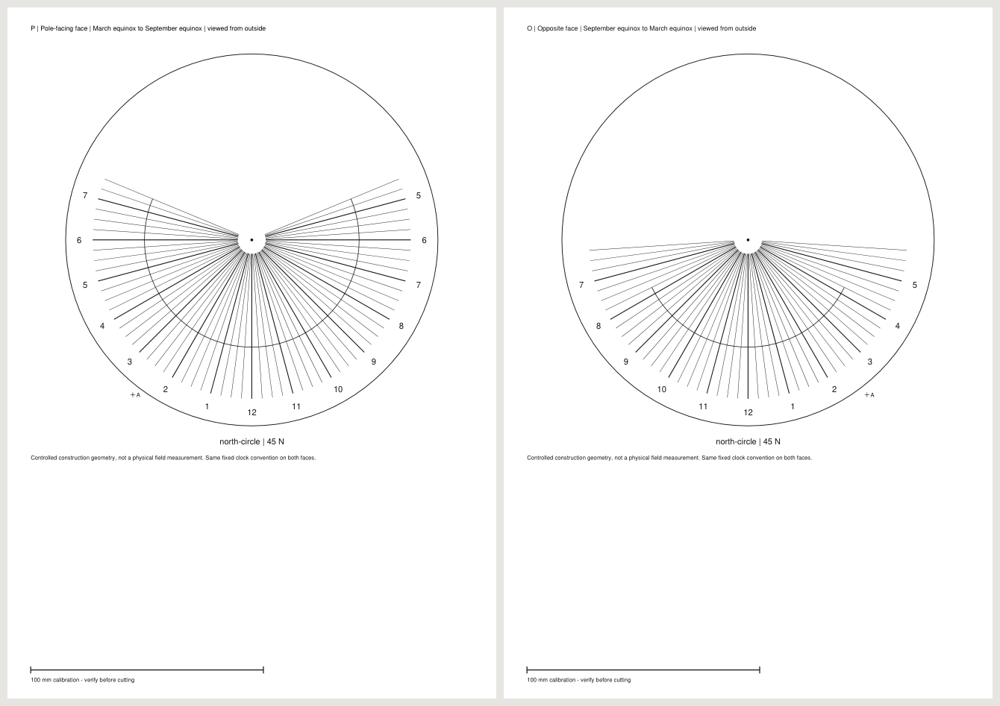

# Print both sides of an equatorial sundial

The previous kit contained only the pole-facing dial and one rod gauge.
That face receives sunlight for one half of the year. A second print of the
same face on the back has the wrong viewed hour order. This extension supplies
the opposite face, a shared physical cut and assembly instructions. It also
fixes a separate polar azimuth defect found in the actual drawings.

The construction principle is established:
[Carl Sabanski's equatorial kit](https://www.mysundial.ca/sdu/sdu_equatorial_sundial.html)
explains the two seasonal faces and the longer hour range on the upper face.
Gnomon adds location-specific daylight geometry, existing clock conventions,
fan cuts, measured vector output and large-piece tiling.

Open the [three-page northern kit](artifacts/north-circle.pdf) or
[southern fan](artifacts/south-fan-zone.pdf). These are controlled mathematical
designs, not observations of a physical build. The northern example is 45 N,
longitude zero, local apparent solar time, radius 80 mm. The southern example
is 33.9 S, longitude 151.2093, reference meridian 150, no daylight adjustment,
also radius 80 mm. Enter your own location before making a dial for use elsewhere.



## Assemble the two faces

Print at **Actual size / 100%**, one-sided, with automatic duplex, Fit and
extra poster tiling disabled. Check every 100 mm bar and both axes of tiled
frames. P-sheets belong to the pole-facing print; O-sheets belong to the
opposite print. Assemble those groups separately.

```text
outside view        one rigid backing          outside view
P print       ->   |                   |   <-  O print
                  +---- thin rod ------+
                    L               L

exposed rod on each side = L
whole rod length        = 2*L + backing thickness
```

Keep both prints facing outward. Align their filled foot dots and target A
through the backing before trimming. Those two physical points fix position
and rotation. A is outside the cut and is an assembly aid. Away from the poles,
page-up on both prints is uphill on the tilted disc. Support it without
obscuring either face. The kit supplies a rod gauge and tilt angle, not a
support-frame cutting template. If using date curves, add a bead or notch at
the stated nodus distance on **each** exposed half, measured from that side's
outer surface. The gauge's ink cross cannot cast a distinct shadow.

| Location | Pole-facing side is lit | Opposite side is lit |
| --- | --- | --- |
| Northern hemisphere | March equinox to September equinox | September equinox to March equinox |
| Southern hemisphere | September equinox to March equinox | March equinox to September equinox |

These ranges identify which face can receive the ideal point Sun, not daylight
at every hour. A geographic pole has no illuminated winter face during polar
night. At the equator the library uses the north-facing side as primary.
At the ideal equinox the Sun's rays lie in the plate plane, so neither face
gives a usable reading.

Both sides retain the **same** apparent or zone-time convention. A summer
clock adjustment stays fixed on the winter face; the kit does not switch DST
between faces. Zone-time designs still require an equation-of-time correction.
The designer preview, simulator and ordinary SVG/PNG download remain
pole-facing. The PDF contains both faces; the example below also exports
their separate SVGs.

## Shared physical geometry

Each face has its own outward normal and rod half. We keep the same physical
upward direction and reverse the in-plane right direction on the back. Hour
rays and nodus curves are projected onto that receiving face. Hours that cannot
occur in daylight there are omitted.

Winter has fewer usable hours, so two independently minimized fan cuts might
not fit one backing. We choose one sector containing both sets of rays in a
shared physical frame, then reflect that cut into the back's viewing frame.
The alignment target follows the same reflection.

`buildEquatorialDial` keeps its default pole-facing output and now carries
`equatorial.counterpart`, another `PolarDialResult`, plus face/calendar/cut
metadata. Only the requested side carries a counterpart, keeping the graph
acyclic. Set `face: "opposite"` to request the back first.
`buildEquatorialPlane` exposes the corresponding plane for library simulation.
`exportPolarDialPDF` still exports one face; `exportConstructionPDF` includes
both available faces and the rod gauge.

## Independent measurements of native output

Baseline: `1acc6ad039d4003b7547ffa0e6f65abe7956a953`.
[Before](results/before.json) and [after](results/after.json) measurements retain
the original capture manifests and native files in the
[before archive](artifacts/before.tar.gz) and [after archive](artifacts/after.tar.gz).
Manifests identify all source inputs, script identity and output SHA-256 hashes.
The verifier imports none of Gnomon's astronomy, geometry, rendering or print
planning functions.

`measure.py` reads actual SVG coordinates, PDF vectors, clipping frames and
paper dimensions. It checks analytical daylight existence and signed hour-ray
directions, associates the printed hour numerals with those directions,
reconstructs the Sun from date-curve vertices and segment midpoints,
and compares reflected cuts and alignment targets. It also checks complete
printed-stroke coverage by the union of actual PDF tile frames translated by
each tile's serialized foot. Off-sheet commands alone do not count as printable
coverage. Every page must contain a native 100 mm bar.

| Captured output | Previous source | New source |
| --- | ---: | ---: |
| Controlled configurations | 15 | 15 |
| SVG face drawings | 15 | 30 |
| Native SVG hour rays inspected | 841 | 1,383 |
| Native PDF hour rays, including tile copies | 2,022 | 3,521 |
| Incorrect SVG / PDF ray directions | 140 / 140 | 0 / 0 |
| Date vertices inspected, including tile copies | 2,968 | 4,498 |
| Complete printed stroke segments, including alignment crosses | 3,144 | 5,622 |
| Compact kit pages | 2 | 3 |
| 300 mm circle kit pages | 6 | 11 |

These are retained controls, not a failure-rate estimate. The cases cover both
hemispheres, equator and geographic poles, polar daylight, asymmetric zone-time
fans, both paper formats, an opposite-first call, a one-hour fan, restricted
hours, and an 800 mm plate with a tiled rod gauge.

The old pole cases had **70 distorted rays each**, with error up to 11.25
degrees. The azimuth expression subtracted nearly equal quantities and divided
by `cos(latitude)`. Expanding its horizontal north component removes the
cancellation and near-zero division. The new native SVG direction discrepancy
is at most 0.000524 degrees here, including three-decimal SVG serialization.
PDF direction-vector error must stay below `1e-6`; the SVG bound is `3e-5`.
The largest date-curve chord discrepancy is 0.011463 degrees, within the
3.75-degree sampling's 0.02-degree allowance. Baseline polar date chords are
retained but excluded from that bound because their directions were distorted.

The new capture checks 1,251 native hour numerals, including SVGs and repeated
PDF tiles, plus the actual rod gauge and nodus distances. Three
[authored output faults](results/faults.json) change a back-face numeral, reverse
one back-face ray, or shorten the rod gauge by 3%. Each has an updated, internally
consistent hash manifest; all three are rejected on the native evidence.

The fresh Node 24.22.0 install passes lint, strict types, 336 tests in each of
the default and German locales, the build and 84 Chromium/Firefox workflows.
Eight new offline scenarios cover both hemispheres at 375 and 1440 pixels.
Their **24 actual PDF downloads, 136 pages**, receive the same independent
native checks: 5,040 hour-ray copies and 1,248 printed numerals, matching cuts,
complete stroke coverage and rod/nodus dimensions. These files and the real
Export-panel screenshots are in [browser.tar.gz](artifacts/browser.tar.gz), with
[measurements](results/browser.json). Reproduce them with:

```sh
npm run build
npx playwright test tests/browser/equatorial-faces.spec.mjs
uv run --script studies/equatorial-faces/browser-measure.py test-results /tmp/equatorial-browser-measurements.json
```

These digital checks do not establish printer scale, material tolerances,
support rigidity, physical assembly, penumbra, atmospheric refraction or outdoor
time-reading accuracy. No physical field trial has been performed.

## Reproduce

From an installed source checkout with Node 24+:

```sh
node examples/equatorial-kit.mjs /tmp/equatorial-kit 37.7749
```

This writes separate face SVGs, a rod gauge and an A4 PDF for a 160 mm circular
plate in local apparent solar time. With `uv`, run the native study:

```sh
node studies/equatorial-faces/replay.mjs . /tmp/equatorial-capture after
uv run --script studies/equatorial-faces/measure.py /tmp/equatorial-capture /tmp/equatorial-measurements.json
```

The pinned PyMuPDF reader inspects the saved files. To check a retained archive,
extract it into an empty directory and pass that directory to `measure.py`.
Pass a baseline checkout to `replay.mjs` with `before` to retain its missing-face
output and observed polar errors.

Browser downloads, clean-install checks and source/hosting publication are
recorded separately in [verification](results/verification.json).
