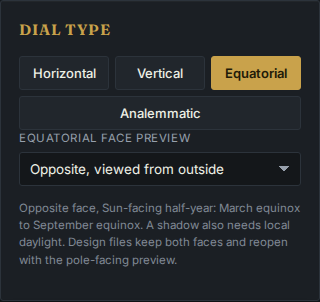
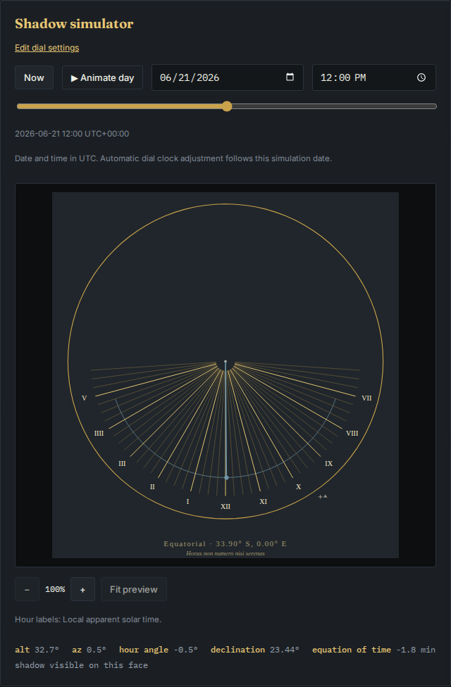

# Inspect either outside face before making the kit

The [two-face construction kit](../equatorial-faces/README.md) supplies
both halves of an equatorial dial. The browser previously always previewed
the pole-facing face. The designer now exposes **Equatorial face preview**
under **Dial type**: choose the pole-facing or opposite face, each viewed
from outside. The live shadow uses that face's receiving plane.

The hemisphere determines which half-year puts the Sun on each side.
Local daylight is also required; an equinox or polar night does not acquire
a usable shadow by changing the view. This is a view of a complete physical
pair, rather than a new construction setting.

| Action | Result |
|---|---|
| Preview | Selected outside view, its receiving season and live shadow |
| SVG or PNG | Selected face; opposite filenames contain `-opposite` |
| Construction PDF | Both faces, selected face first, followed by the rod gauge |
| Save design | Existing version 1 physical settings and fixed clock minute; identical from either face |
| Open design | Restore the complete pair and start with its pole-facing preview |





SVG remains in millimetres. PNG is a raster image, not a print-scale
guarantee. Both faces share the same cut and clock convention within a kit.
The existing laser template, full-size PDF tiling, alignment target and rod
dimensions retain their construction roles.

## Actual browser exports

Eight offline workflows cover Chromium and Firefox at 1440 and 375 px for
manual sites at 37.7749 and -33.9 degrees latitude, longitude zero, UTC.
Each uses apparent solar hour labels, an 80 mm circle and both June 21
and December 21 at local noon. These are controlled sites, not a claim
that longitude zero is San Francisco or Sydney.

| Evidence | Measured result |
|---|---:|
| Face / season / hemisphere states | 32 |
| Individual SVG downloads | 32, with 1,680 independently checked hour rays |
| Opposite-first PDF downloads | 8, containing 24 pages and 840 checked hour rays |
| Native hour numerals, SVG and PDF | 624 checked against their hour and outside view |
| Opposite-face PNG downloads | 8 at 2078 x 2196 pixels; decoded pixels equal the independently rasterized selected SVG |
| Portable designs | Identical saves from either view; all eight reopen on the pole-facing view |

The browser checks the illuminated face from the hemisphere and solstice,
then checks the live shadow direction and length using the displayed hour
angle and declination in a separate closed-form equatorial calculation.
Its 0.25 mm comparison bound accounts for the readout's rounded angles
(hour angle to 0.1 degree, declination to 0.01 degree). Receipts retain
the actual SVG shadow coordinates and comparison error for all 16 lit
states, and explicitly retain the 16 unlit states. This is a projection
check, not independent ephemeris validation.

For PNG, the page independently decodes the actual downloaded SVG and PNG,
draws them into fresh canvases at the downloaded dimensions and compares all
RGBA components. All eight measured cases are exactly equal. The regression
permits a two-unit component difference for browser raster rounding; the
retained measurements record zero differing components and matching hashes.
No product rasterization helper is imported into this check.
The raster comparison selects **Laser cut** so the SVG and PNG palettes
agree; the preview screenshots use **Brass**.

[`measure.py`](measure.py) reads the actual SVG and PDF vectors with Python
and PyMuPDF. It imports the earlier study's independent serialized-vector
reader, rather than the product's geometry. It checks every hour direction,
Roman numeral, solstice curve, shared mirrored cut, PDF stroke coverage and
the exposed rod/nodus measurements. It also verifies downloaded hashes,
native PNG dimensions and selected-first PDF page order. The angular oracle
uses the analytical equatorial projection and annual horizon visibility.

The scenarios finish after the app and fonts load and the browser disconnects:
no HTTP requests, page errors, CSP violations, horizontal overflow or detected
accessibility violations. Portable files keep the existing strict version 1
schema. Face changes participate in the existing immutable export snapshot
and design-read revision handling; opening an invalid file still preserves
the current work.

These are serialized geometry, raster and browser workflow observations.
Physical printing, alignment, backing thickness, rod installation and outdoor
accuracy still require a real construction and field trial. No mounting
support is supplied.

## Reproduce

From a checkout with Node 24 and the locked dependencies installed:

```sh
npm run build
npx playwright test tests/browser/equatorial-preview.spec.mjs
uv run --script studies/equatorial-preview/measure.py test-results /tmp/equatorial-preview.json
```

The independent reader uses pinned PyMuPDF 1.28.2 and Python 3.11 or newer.
Run the measurement after the browser scenarios complete so all eight case
directories are present. The same checks can target the public page using
an alternate Playwright configuration with the hosted base URL and no local
web server. Publication receipts distinguish that observation from the source
checkout and the clean local build.

The [clean-install receipt](results/verification.json) records Node 24.22.0,
lint/typecheck, 336 unit cases in both required locales, the production build
and 92 passing browser workflows. The [native face measurements](results/browser-measurements.json)
retain each projection coordinate and error; the maximum is 0.046 mm against
the rounded readout. The [legacy PDF replay](results/legacy-pdf-measurements.json)
independently checks another 24 downloads, 136 pages and 5,040 ray copies,
including both hemispheres and tiled kits. The
[original downloads and screenshots](artifacts/browser.tar.gz) retain the
eight new workflows. All 16 preview/control screenshots were opened and
visually inspected, including the actual 375 px layouts.
