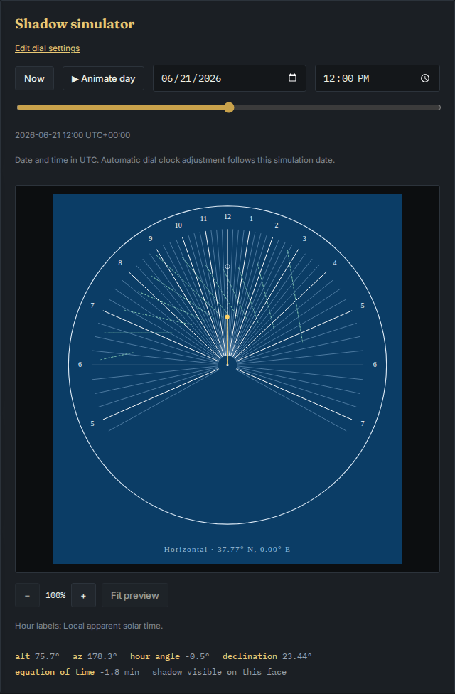

# Source, offline downloads and emitted geometry

Verified on 2026-10-14 from fresh source archives of code `da1c215` and baseline
`12e072d`. Additional harness corrections retain the actual laser-format export
contract. Runtime and build inputs are byte-identical across the working source
and both independently installed archives. No hosted deployment is included.

| Check | Result |
|---|---|
| Independent horizontal model, Node 26.7.0 and 24.21.0 | 27 cases; baseline 13 disagreements and 75 missing curves; corrected zero |
| Corrected sampled coordinates | All 9,597 points agree; maximum absolute reference difference 2.91e-10 mm in these model cases |
| Native results across Node versions | Full model records and six export records identical |
| Six frozen editable input files | Before/after bytes unchanged |
| Fresh Node 26 archive | npm ci, lint, types, 303 unit checks, build and 68 Chromium/Firefox workflows passed |
| Fresh Node 24 archive | npm ci, lint, types, 303 unit checks and build passed |
| Source and build-input parity | All 65 tracked inputs match both archives and working source |
| Node 26/24 production builds | All 33 generated files have identical hashes |
| Files actually served by both study previews | All 66 before/after files match their built bytes |
| Separate offline export study | 48 before/after workflows; all 24 corrected exports match complete-model path counts, versus zero before |
| Actual SVG downloads | All 48 match native laser-format SVG bytes |
| Independent measurement of actual PDF downloads | 48 PDFs, 96 pages, 96 calibration bars; every visible historical path and vertex agrees with its SVG within 0.002 mm |
| Offline requests, page exceptions and document overflow | Zero in the separate export study |

The model's coordinate agreement is an implementation check, not a claim of
2.91e-10 mm physical accuracy. It shares the documented solar-declination
approximation. The largest SVG/PDF vertex difference is 0.000700 mm, including
SVG rounding and PDF-reader precision. The largest digital calibration-bar
error is 0.00000413 mm. Printer scaling, mounting and outdoor behavior remain
unverified.

The six export inputs cover northern/southern horizontal Italian dials,
northern/southern long-day Babylonian dials, a vertical Italian dial and an
equatorial Italian dial. Every case opens its frozen `.gnomon.json` offline,
downloads the actual SVG and A4 construction PDF, and checks page behavior at
1440 and 375 pixels in both engines. The PDF reader uses PyMuPDF 1.28.2 and
compares decoded vectors with SVG vertices after independently reading their
circle centers. It imports no Gnomon layout or renderer helpers.

The initial browser comparison mistakenly used a colored preview SVG as the
reference for the app's laser-format download. The reference now captures both
formats. A subsequent rapid one-tab pass timed out on the eleventh download;
each design now runs in its own browser context. Both failure logs remain
retained locally. No browser-engine or product-renderer repair is claimed.
The PDF reader initially tried to read a stroke width from a filled shape;
it now selects stroked historical paths. Its original error log is retained.

Reproduce the native capture with `node studies/historical-hours/replay.mjs`.
For before/after offline browsers, run:

```bash
node studies/historical-hours/browser.mjs --before /path/to/built-baseline --after /path/to/built-source --native-before studies/historical-hours/results/before --native-after studies/historical-hours/results/after --out /tmp/historical-browser
uv run studies/historical-hours/measure.py --browser /tmp/historical-browser --native-before studies/historical-hours/results/before --native-after studies/historical-hours/results/after --out /tmp/historical-pdf.json
```

The browser script checks the bytes it serves before opening its workflows.
Each source archive must have completed `npm ci && npm run build`. Full source
checks were `npm run lint`, `npm run typecheck`, `npm test`, `npm run build`, and
`npx playwright test` after a clean install. The builds produce `dist/`.

[Artifact receipt](results/artifact-verification.json),
[model capture](results/after/results.json),
[browser receipt](results/browser/results.json), and
[independent PDF measurements](results/pdf-measurements.json) retain the checks.
The actual PDFs and eight study screenshots are in `results/browser/`; all
screenshots were visually inspected, along with six existing-suite captures.



The added curves use the existing styling and clipping. Historical curves
remain unlabelled, and curves outside the plate remain unprinted. The remaining
approximation and physical-validation boundaries are in the study README.
