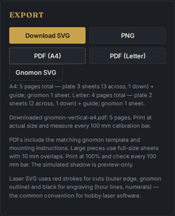
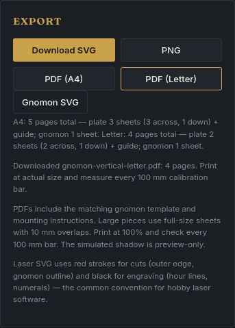

# The first construction PDF after disconnecting

At source `c656355`, a freshly loaded designer could export SVG while offline,
but its first PDF required another script download. Chromium and Firefox both
failed with no file for A4 and Letter. The [four baseline observations](before-failures.json)
retain the failed requests and visible errors.

Implementation `4707603a853a006343cd9082c79edf6ebbcedfd3` imports the vector PDF
writer with the application. Once the designer appears, it can create the
first PDF offline. No drawing calculation changed. This is a source correction;
it has not been deployed to the hosted demo.

## Real downloads, including edits after disconnecting

[The replay](replay.mjs) creates a fresh browser context for every combination
of Chromium/Firefox, 1440/375 CSS pixels and A4/Letter. Each loads the app and
fonts, goes offline, opens the Rome example design, then exports its **first**
PDF. No previous PDF download, module warmup or browser cache from another
context can satisfy the check. The example changes location, wall angle, radius
and simulation date after disconnecting.

| Observation | Baseline | Corrected source |
| --- | --- | --- |
| First PDF after disconnecting | All four browser/paper cases fail to fetch the writer | All eight browser/paper/width cases download |
| Network requests after disconnecting | Failed PDF script request | None |
| Generated drawing | Successful online exports retained as controls | Same bytes except random PDF file IDs |
| Page comparison | 8 online PDFs, 36 pages | Corresponding page dimensions and every rendered pixel match |

The [online controls](before-online.json), [offline downloads](after-offline.json)
and [comparison receipt](verification.json) retain the actual file hashes.
[All 16 PDFs](downloads.tar.xz) are preserved in an XZ-compressed tar archive;
their extracted bytes were checked against the original downloads. The PDFs
contain constructed settings for a public Rome location, not a measured wall.

The [independent reader](verify.py) compares the complete PDF bytes after
normalizing only the random file-ID entry. It also uses PDFium to compare
all 36 corresponding page dimensions and every RGB byte rendered at 144 dpi.
This preserves the former online drawing; it is not a new physical accuracy
measurement. The A4 kits have five pages and the Letter kits have four.

Every served response matches its build: nine assets before, eight after.
The complete 33-file corrected build manifest is in the comparison receipt.
No uncaught errors, external requests or horizontal overflow were observed.
Both retained export-panel screenshots were opened and visually inspected:

| Chromium desktop | Firefox, 375 px |
| --- | --- |
|  |  |

## Initial-load cost

The writer's transfer moves to initial loading. The replay measures decoded
JavaScript bytes loaded before any export, plus a gzip level-9 size estimate:

| Initial JavaScript | Before | After |
| --- | ---: | ---: |
| Decoded bytes | 67,929 | 467,534 |
| Gzip level-9 estimate, bytes | 23,966 | 155,854 |

These are build sizes, not network timings or guaranteed server compression.
The extra initial transfer is 131,888 estimated compressed bytes. PDF drawing
code and its existing dependency are unchanged; no new dependency was added.
The application still needs to load before disconnecting. This change does
not provide an offline reload, installation or service worker.

## Clean verification and replay

A fresh archive of the implementation matched all 176 tracked files. With
Node 24.21.0 and npm 12.0.1, locked installation, types, lint, 294 unit checks,
production build and 68 Chromium/Firefox workflows passed. See
[check metadata](checks.json), [clean check output](clean-checks.txt) and
[browser output](clean-browsers.txt). Final evidence additions leave tested
runtime files unchanged.

To repeat the download comparison, build baseline `c656355` and the corrected
source separately with `npm ci && npm run build`. Serve their `dist/` directories
on ports 4319 and 4320 with Vite preview. From the corrected checkout, with
Playwright's Chromium and Firefox already available:

```bash
node studies/offline-pdf/replay.mjs http://127.0.0.1:4319/gnomon/ /tmp/gnomon-before-online online
node studies/offline-pdf/replay.mjs http://127.0.0.1:4320/gnomon/ /tmp/gnomon-after-offline offline
python -m venv .venv-artifacts
.venv-artifacts/bin/pip install pypdfium2==5.14.0 Pillow==12.3.0
.venv-artifacts/bin/python studies/offline-pdf/verify.py /tmp/gnomon-before-online /tmp/gnomon-after-offline ../gnomon-before/dist dist /tmp/gnomon-pdf-comparison.json
```

Use new output directories and adjust the baseline build path. The checked-in
receipt used the preceding verified clean build for the baseline; the intervening
`c656355` commit added only evidence and documentation. Printer scale, paper
assembly, mounting measurements and outdoor readings remain outside this check.
