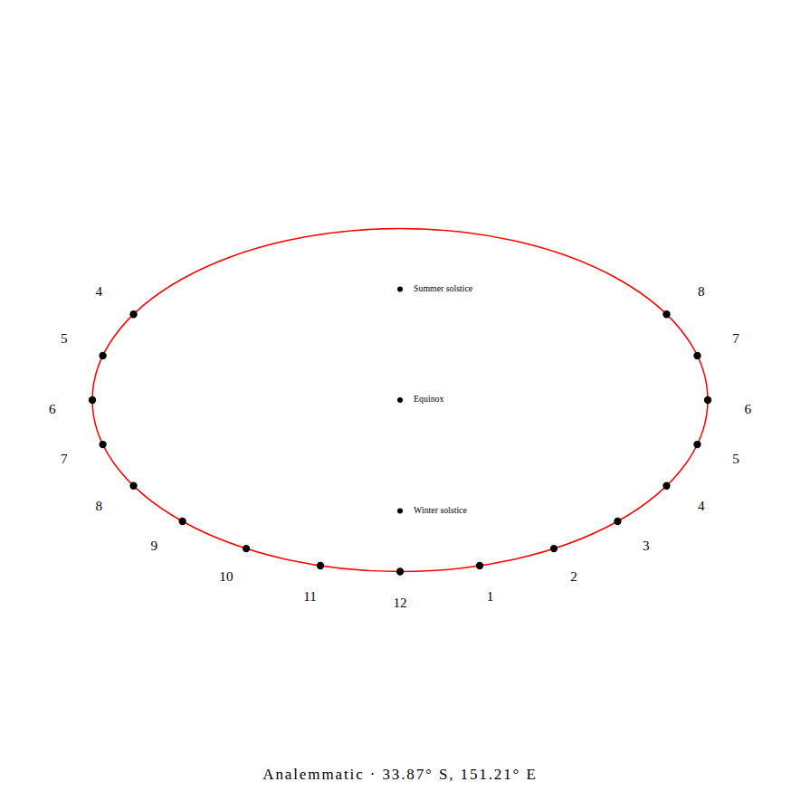

# Read the standing date in either hemisphere

The old Sydney analemmatic drawing called its northern standing mark
**Summer solstice**. That mark is June, which is Southern Hemisphere winter.
The lower mark is December. [NASA's seasonal reference](https://science.nasa.gov/solar-system/skywatching/night-sky-network/tropical-solstice-shadows/)
explains the reversed seasons; month names avoid the ambiguity everywhere.

On a 90 mm semi-major axis at latitude -33.8688, following the old local-summer
name put the rod at +32.3998 mm instead of -32.3998 mm: a **64.7997 mm** displacement.
This is the consequence of the ideal geometric model, not a field measurement.

| June / northern mark | December / southern mark |
|---|---|
| Northern summer, southern winter | Northern winter, southern summer |
| +23.44 degrees declination | -23.44 degrees declination |




## Use the drawing

Keep the plate level with its top toward true north. Use a **vertical** rod,
checked with a plumb line, and put its base at the matching date mark. Follow
the shadow direction to the ellipse to read local apparent solar time. The
setup card now follows this model; polar dials retain their polar-style setup.

The scale shows solstice/equinox marks and optional zodiac entries. It does not
label every calendar day. For another date, the ideal standing offset is
`R * cos(latitude) * tan(solar declination)`, positive toward true north.
The fixed solstitial declination is the existing 23.44-degree approximation.
This correction changes its calendar names, not the ephemeris or geometry.

An old drawing with Summer at the northern mark and Winter at the southern
mark can be relabelled June and December. The native marks, ellipse and hour
points already have the correct Southern Hemisphere geometry. Existing
`.gnomon.json` files open without conversion.

## What was checked

The original source is `3d9a8cf`; the correction begins at `f729f44`.
[Before](before/replay.json) and [after](after/replay.json) use 16 controlled
cases: four northern/southern latitudes, two physical sizes, and both solstices.
An independent east/north/up Sun vector at apparent solar 15:00 must point the
rod's shadow from the **printed date mark** toward the intended hour point.
The eight incorrect Southern Hemisphere cases become zero. These are checks
of the selected labels and ideal geometry, not a general accuracy estimate.

[Full design snapshots](geometry-controls.json) across all four dial types are
identical after normalizing only the two human date labels. Legacy `kind`
identifiers (`solstice-summer` / `solstice-winter`) retain their existing values;
use the label or numeric declination for calendar meaning.

Actual Chromium/Firefox desktop and 375px runs load the designer, disconnect,
open the [portable Sydney setup](before/Sydney.gnomon.json), download its SVG and
save the setup again. The setup bytes remain identical. All four actual laser
SVGs differ only in the two engraved calendar names:
[download comparison](download-controls.json), [before browser](before/browser.json),
[after browser](after/browser.json). All captured screenshots were reviewed;
page errors, extra offline HTTP and page overflow are absent. PDFs remain
unavailable for the movable-rod layout, as indicated by its export controls.

To replay from a checkout with Node 24:

```bash
node studies/seasonal-marks/replay.mjs . /tmp/gnomon-standing-check
```

Pass an older checkout as the first argument to reproduce its labels. With a
built designer running, `browser.mjs URL DESIGN_FILE OUTPUT_DIR before|after`
repeats the actual portable-file and native SVG workflow.

## Public designer

Source `4bd6661` and Pages `2723d00` publish the clean `49b838c` build.
All 33 built files and the root URL match exactly: [served bytes](hosted-bytes.json).
The [public replay](hosted/browser.json) opens the same Sydney file offline,
saves unchanged inputs, and downloads/reopens the four native SVGs. Its eight
screenshots are byte-identical to the reviewed local captures. The separately
hosted designer was previously older than the checkout and lacked this input
workflow; it now serves the verified current build.

The same disconnected contexts then switch to a horizontal dial and download
their first A4 and Letter construction kits. An independent PDF parser checks
all eight files, both pages per kit and every 100 mm calibration bar:
[PDF measurements](hosted-pdf.json), [publication boundary](publication.json).
This checks native documents and browser behavior, not physical printer scale
or a built sundial. The movable-rod layout still exports SVG/PNG.
