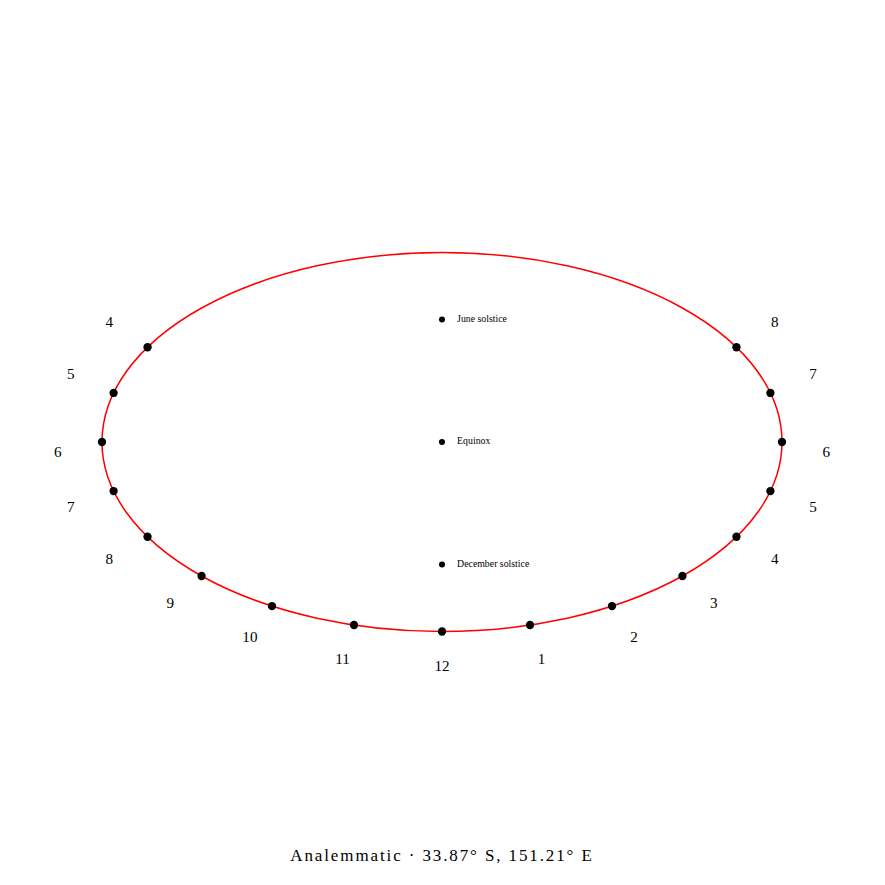
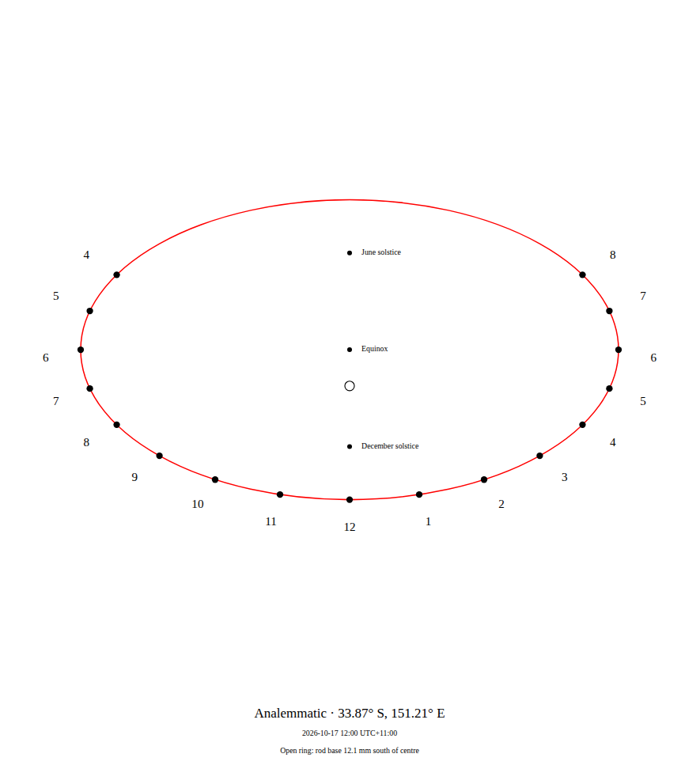

# Place the rod on an ordinary selected date

An analemmatic sundial needs a vertical rod at a date-dependent position.
The former designer marked only solstices, equinox and optional zodiac entries;
its date/time controls were hidden for this layout. There was no printed point
for an ordinary chosen day.

Select **Analemmatic**, choose a local date and time, and put the rod's base at
the **open ring**. The preview, mounting guidance and native SVG/PNG retain the
same point. The drawing's legend names the local minute and its UTC offset,
plus a north/south distance from the ellipse centre. June/December calendar
marks and the apparent-solar hour points retain their existing geometry.





The [Sydney example](before/Sydney-October.gnomon.json) selects 17 October 2026
at 12:00, UTC+11:00. Its 90 mm semi-major axis puts the ring **12.1 mm south of
centre** (rounded for the printed readout). Change the local time to 18:00 and
the actual exported point changes, rather than reusing a day-only cached design.
These are ideal model coordinates, not measurements of a built sundial.

## Clock and construction boundaries

The position is `R * cos(latitude) * tan(solar declination)`, positive toward
true north in either hemisphere. The existing solar ephemeris supplies the
selected minute's declination. Its accuracy model is unchanged. The printed
0.1 mm readout is display precision; native SVG coordinates retain 0.001 mm
serialization. Neither establishes physical fabrication accuracy.

The mark freezes the same **civil minute** as the existing portable input file.
It distinguishes both occurrences of a repeated clock time and retains old
UTC offsets containing seconds. Inputs remain version 1; existing saved files
open without conversion. Async exports retain the design selected at the click.
Selecting another dial type does not discard a chosen date.

Time fields select the instant; hour marks still read **local apparent solar
time**, not that civil clock. The rod stays vertical. This adds no animated
shadow, fixed-style cutting template or PDF for the movable-rod layout.

## Independent native checks

[Before](before/replay.json) is source `57fc8c2`; the capability begins at
`c67dc85`. Thirty actual SVG drawings span two hemispheres, semi-major axes
30/90/400 mm and five retained DE421 dates. An independent XML reader recovers
the printed standing offset and inverts it to solar declination. An independent
east/north/up Sun vector then checks that the printed point's shadow direction
reaches the actual 15:00 hour dot. Across these controlled files, maximum
errors are 0.0041 degrees in declination and 0.0045 degrees in direction:
[serialized geometry](after/artifacts.json). These bounded numerical checks
are not a new ephemeris or field-accuracy estimate.

All 30 fixed calendar/hour geometries and 90 complete polar SVG drawings
remain identical: [controls](controls.json). Sixty actual browser layouts
check every native text box in both font renderers without clipping:
[layout measurements](layouts.json). Small drawings wrap their legend below
the physical geometry instead of shrinking text into it.

A separate [Skyfield 1.54 / DE421 capture](download-oracle.json) supplies the
actual browser example's two selected-minute declinations, plus the repeated
and historical clock cases. The 16.8 MB kernel stays in a local cache; its hash
and exact date values are retained. The script imports no product ephemeris.

Four Chromium/Firefox desktop/mobile contexts load the designer, disconnect,
open identical inputs, download native SVG and PNG, save unchanged input bytes,
and reopen the SVG. They then edit the local time and download the new point
and editable inputs. Independent measurement checks all eight downloaded SVGs
against the separate ephemeris:
[actual native downloads](local-after/browser.json),
[downloaded-point measurements](local-after/artifacts.json).
The original public designer's [before capture](before/browser.json) retains
its four ordinary SVGs without a selected-date mark.

## Replay

With Node 24 and repository dependencies installed:

```bash
node studies/selected-standing/replay.mjs . /tmp/gnomon-standing after
python3 studies/selected-standing/measure.py --capture /tmp/gnomon-standing --out /tmp/gnomon-standing-vectors.json --phase after
```

Pass a checkout at `57fc8c2` and `before` to inspect the original. The native
checker uses the committed independent date table and Python's standard library.
`layout.mjs CAPTURE_DIR RESULT.json` measures native text bounds in both browsers.
`browser.mjs URL INPUT.gnomon.json OUTPUT_DIR before|after` repeats the actual
offline input, native SVG/PNG and same-day edit workflow. To measure these files,
add `--browser OUTPUT_DIR --input INPUT.gnomon.json --oracle
studies/selected-standing/download-oracle.json` to the Python command.

To regenerate the independent selected-minute date values, run
`uv run --script studies/selected-standing/capture_oracle.py --cache CACHE_DIR
--out RESULT.json`. It downloads JPL DE421 on first use and pins Skyfield 1.54.
No runtime dependency or network operation was added to the designer.

[Clean archive verification](verification.json) records `a9c60ff`, a fresh Node
24.21.0 install, lint/type checking, 312 unit checks in each of two number
locales, build, native-vector replay and 74 actual Chromium/Firefox workflows,
all completed with exit 0. Independent [PNG pixel measurements](png-geometry.json)
locate the selected ring in both actual raster downloads against the separate
DE421 date input; the old images contain no ring there. This checks actual
pixels, rather than inferring correct drawing content from image dimensions.
