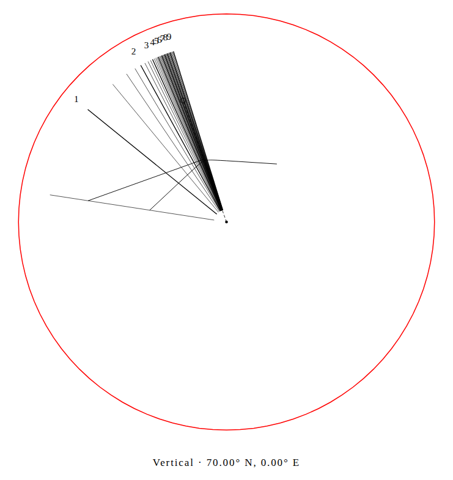

# A date curve cannot cross an unlit interval

A vertical wall at latitude 70 degrees, facing 100 degrees west of south,
receives June sunlight in separate parts of the polar day. The former date
curve discarded every unusable shadow projection, then connected the remaining
points. On a full-circle plate this drew a straight line between unrelated
visible branches, in the designer, native SVG and construction PDF.

The controlled 90 mm example has a physical nodus 28.8 mm from the foot along
the polar style. Inverting the Sun direction from the false segment's midpoint
gives **85.49 degrees declination**, although this is the **23.44-degree June
curve**. This is an impossible date line in the ideal model, not a field error
measurement. Open [the original editable inputs](before/Polar-wall.gnomon.json)
in the designer to inspect this case.

| Old native download | Corrected native download |
|---|---|
|  |  |

## Preserve the missing evidence

The generator samples hour angles from -180 through +180 degrees at 3.75-degree
intervals. It now retains a `null` for each unusable projection. The shared
SVG/PDF clipper ends its current path at that sample. Valid point coordinates,
physical units and portable design files are unchanged.

`DeclinationLine.points` is now `(PlanePoint | null)[]`. Preserve the positions
when drawing connected curves. Filtering nulls is suitable for a point cloud,
but recreates this defect when the result is drawn as one polyline. The older
`HistoricalHourCurve.points` contract is unchanged.

This does not solve visibility boundaries analytically. A very narrow window
between sample positions can still be missed. Terrain, refraction, fabrication
and field performance remain outside this check.

## Independent checks of the actual vectors

[Before source](before/replay.json) is `2a6f7b3`; the correction begins at
`0bb1b01`. Eight controlled cases mirror north/south and east/west faces at
radii 90 and 350 mm. Each case exports circle and fan SVG; the four compact
cases also export a construction PDF. The original **12 false segments in 20
native documents become zero**. Eight fan drawings were already clipped safely
and remain byte-identical; every original finite coordinate is identical:
[unaffected controls](controls.json).

The checker reconstructs a Sun direction from a drawn point `P` toward the
physical nodus `N`. Its dot product with the north celestial axis gives the
sine of declination. It imports no product projection helpers. Each date path's
vertices and segment midpoints must retain its fixed declination and keep the
Sun above the horizon. Native unrounded chords allow 0.02 degrees; serialized
SVG/PDF checks allow 0.1 degrees for sampling and 0.001 mm SVG rounding. These
are bounded checks of these controlled drawings, not a general ephemeris
accuracy claim. [Before vectors](before/artifacts.json),
[after vectors](after/artifacts.json).

Actual Chromium and Firefox sessions at 1440 and 375px load the designer,
disconnect, open the same editable file, save identical inputs, download native
SVG and first A4/Letter PDFs, and reopen the SVG. The original public designer
produced 12 downloads with false segments; the corrected local build produces
12 with none. An independent parser measures all PDF sheets' 100 mm bars.
Screenshots of both phases were reviewed; no page errors, extra offline HTTP
or page overflow occurred. [Public before](public-before/browser.json),
[before measurements](public-before/artifacts.json),
[local after](local-after/browser.json),
[after measurements](local-after/artifacts.json).

## Replay

With Node 24 and the repository dependencies installed:

```bash
node studies/shadow-gaps/replay.mjs . /tmp/gnomon-shadow-check after
uv run --script studies/shadow-gaps/measure.py --capture /tmp/gnomon-shadow-check --out /tmp/gnomon-shadow-vectors.json --expect after
```

For the original, pass a checkout at `2a6f7b3` and use `before` instead.
The metrology script pins PyMuPDF 1.28.2 and reads this writer's known date
strokes and circle plates; it is not a general PDF semantic extractor.
`browser.mjs URL DESIGN_FILE OUTPUT_DIR before|after` repeats the real offline
workflow. To measure its downloads, add `--browser OUTPUT_DIR` to `measure.py`
while retaining the native `--capture` for physical case metadata.
